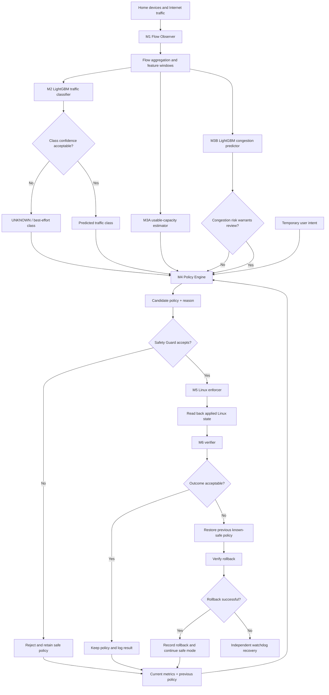
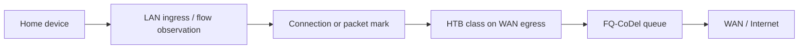
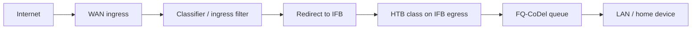
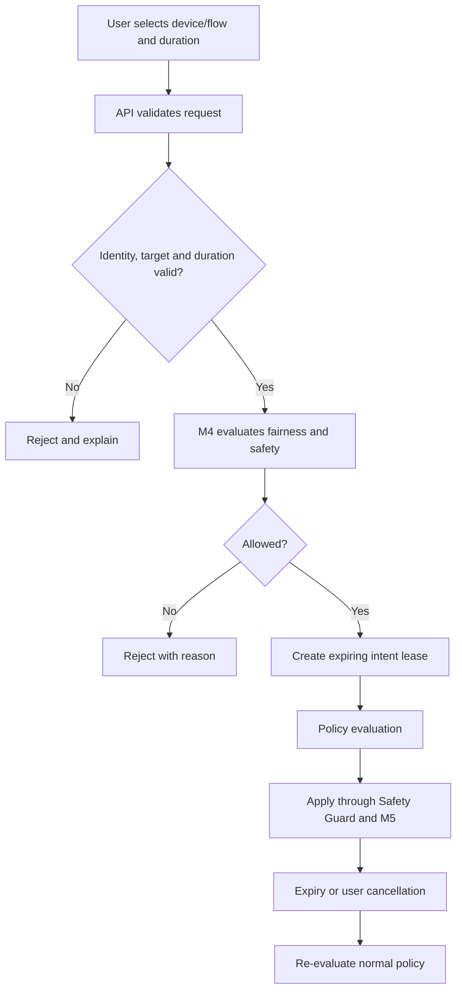

# QoSense Detailed Architecture

## 1. System context

QoSense has four logical planes:

1. **Data plane:** the real packets moving between home devices, the Linux gateway and the WAN/Internet.
2. **Analytics plane:** flow features, two ML models, capacity estimation and performance measurements.
3. **Control plane:** policy engine, safety guard, enforcement manager, rollback and watchdog.
4. **User plane:** dashboard, experiment controls, temporary priority requests and event/history views.

The analytics/control path observes and decides; it is not the same as the packet path. A LightGBM model does not receive every packet and forward it. M1 aggregates flow observations into feature windows; M2/M3B infer on those feature windows. The controller maps a flow classification to a validated Linux policy/mark.

## 2. High-level decision flow

This is the logical decision flow. The congestion-risk branch is advisory; a high-risk prediction does not skip the policy engine or safety guard.

## 3. Initialization and readiness

1. Start API and dashboard.
2. Connect to the lab agent or select simulation/replay mode.
3. Discover configured interfaces and lab topology.
4. Load model artifacts and verify version/schema compatibility.
5. Read the current Linux traffic-control state when in live lab mode.
6. Verify that the known-safe policy exists and can be restored.
7. Start measurements and heartbeat monitoring.
8. If any required capability is missing, show the exact degraded status and remain in simulation or safe non-enforcing mode. Never claim live control when prerequisites fail.

## 4. M1 — Flow Observer

### Inputs
- Packet/header metadata visible to the controlled Linux testbed.
- Interface and direction.
- Connection/flow identifiers.
- Monotonic timestamps and counters.

### Processing
1. Observe packets using the selected capture adapter (eBPF where implemented; a documented alternative may be used for the first prototype).
2. Associate packets with a flow using a stable flow key.
3. Maintain short observation windows and running statistics.
4. Handle flow expiry, counter reset, missing packets and interface changes.
5. Emit a feature-window event at a configurable cadence or new-flow trigger.

### Output
`FlowFeatureWindow` as defined in `API_CONTRACT.md`.

### Alternatives and decisions
- Do not classify each packet independently; that is wasteful and ignores flow behaviour.
- Do not inspect or store application payloads.
- If capture is unavailable, show observer degraded and do not pretend that live classifications are occurring.

## 5. M2 — Traffic Classifier

### Input
A validated `FlowFeatureWindow` matching the model's feature schema.

### Processing
1. Validate feature names, order, types, units and missing-value policy.
2. Run the versioned LightGBM multiclass model.
3. Convert outputs to class probabilities.
4. Apply a calibrated probability mapping only if a calibration artifact was trained and validated.
5. Apply the configured confidence/unknown threshold.
6. Return predicted class, class probabilities, calibration state, version, inference time and fallback reason.

### Decision branch
- Confidence acceptable and class supported: pass predicted class to M4.
- Confidence low, unsupported feature schema or model unavailable: emit `UNKNOWN`, pass to safe best-effort treatment and record the reason.
- User correction: store as a review/training label; do not silently update the deployed model.

## 6. M3A — Usable Capacity Estimator

### Inputs
Delivery-rate samples, probe RTT, idle RTT baseline, loaded delay trend, packet loss and sample freshness.

### Processing
1. Check sample validity and freshness.
2. Estimate recent delivery rate from measured transfers.
3. Compare loaded and idle delay trends.
4. Smooth valid estimates using a documented EWMA parameter.
5. Apply configured conservative headroom and maximum rate-change limits.
6. Expose uncertainty/quality state.

### Decision branch
- Reliable samples: emit the updated usable-rate estimate.
- Insufficient or stale samples: retain the last validated estimate or use a configured safe fallback.
- Low demand: do not claim passive observations reveal the true maximum capacity; optionally request a bounded probe if the experiment allows it.

The estimator must use observed samples. It must not read the hidden `netem` bottleneck configuration as its own answer.

## 7. M3B — Congestion Predictor

### Input
A chronologically ordered window of observable network measurements at time `t`.

### Target
A congestion event defined using explicit, configurable measurement criteria in a future horizon `(t, t + H]`. The target definition, horizon `H`, sampling frequency and event debounce rules must be documented. Do not select a horizon merely because it looks impressive; use experiments to choose one that can be forecast reliably and early enough to act.

### Processing
1. Build an input window using only information available at or before time `t`.
2. Validate freshness and schema.
3. Run the separately trained LightGBM binary classifier.
4. Apply calibration if validated.
5. Return probability, risk band, horizon, model version and input-window timestamp.

### Decision branch
- Low risk: M4 may keep current policy or make normal small adjustments.
- Elevated risk: M4 evaluates preventive candidate actions.
- Stale/invalid prediction: M4 ignores the prediction and uses current measurements plus deterministic safeguards.

A high predicted risk is not equivalent to measured congestion. Display both separately.

## 8. M4 — Adaptive Policy Engine

### Inputs
- Predicted traffic class and probability/calibrated confidence.
- Usable capacity estimate and quality flag.
- Congestion probability and freshness.
- Current RTT/added-delay trend, jitter, loss and queue state.
- Active traffic flows and measured demand.
- Previous policy and time since last policy change.
- Active user intent, target and expiry.
- Minimum bulk service, fairness and safety constraints.

### Candidate actions
- `KEEP_CURRENT`
- `PROTECT_INTERACTIVE`
- `LIMIT_BULK`
- `REBALANCE_CLASSES`
- `CONSERVATIVE_SAFE`

### Selection method
Start with an explicit deterministic candidate evaluator. Score or rank candidates only using documented measurable/defensible costs such as interactive-delay risk, bulk-progress risk, fairness violations, safety violations and policy churn. Hard safety constraints must reject a candidate regardless of its score. Keep weights/configuration versioned and explainable. Do not copy AQoSE's numerical damage table; design and measure our own approach.

### Branch examples
- Low congestion risk + stable metrics: retain policy or make a small bounded adjustment.
- High congestion risk + reliable capacity: evaluate a bounded proactive action.
- Low classifier confidence: avoid aggressive class-specific action; use best effort.
- Expired or invalid user intent: ignore it and return to normal policy.
- Capacity estimate unreliable: do not make a large rate reduction based only on the unreliable estimate.
- Fairness/minimum-service violation: reject the candidate.
- Hysteresis/cooldown not satisfied: retain the current policy to prevent flapping.

Output a `PolicyProposal` with named policy profile, class/rate configuration, reason codes, source event IDs, constraints and expiry where relevant.

## 9. Safety Guard and M5 enforcement

The Safety Guard validates the proposal before it reaches the lab agent. It verifies bounds, freshness, fair-share floors, total allocation, rate-change limits, policy version, intent expiry and rollback availability.

### Upload packet path

### Download packet path

Exact filter and mark mapping must be verified on the chosen kernel/iproute2 version. IFB allows ingress packets to be redirected to a virtual interface for shaping; it does not control queues already located in the ISP network.

### Transactional apply
1. Read and snapshot current qdisc/class/filter state.
2. Validate the named profile again on the agent.
3. Apply only the predefined operations for that profile.
4. Read back the actual Linux state.
5. If read-back does not match expectation, attempt rollback.
6. Return `APPLIED`, `REJECTED`, `FAILED_ROLLED_BACK` or `FAILED_SAFE_MODE` with evidence.

Do not pass shell strings from a browser to the agent. Prefer typed operations and fixed templates. Use process argument arrays rather than shell interpolation.

## 10. M6 verification and recovery

1. Wait for the configured measurement interval.
2. Collect post-policy measurements.
3. Compare against the baseline/previous measurement using consistent probes and intervals.
4. Evaluate interactive-delay, loss, fairness, bulk-progress and queue criteria.
5. If the defined acceptance rule passes, keep and log the policy.
6. Otherwise restore the saved configuration and read it back.
7. If restore verification fails or the controller stops responding, the independent watchdog activates the known-safe recovery profile.

Separate `policy_apply_time`, `qos_recovery_time` and `stable_duration`; do not use one ambiguous adaptation-time metric.

## 11. User intent path

User intent is time-limited, auditable and subordinate to hard safety/fairness constraints.

## 12. Failure paths

| Failure | Detection | Response |
|---|---|---|
| Model missing/schema mismatch | Model manager/inference wrapper | Ignore model output; safe deterministic class/policy; mark model unavailable |
| Low classifier confidence | M2 threshold | `UNKNOWN` / best effort |
| Stale capacity samples | M3A freshness check | Retain validated estimate or safe fallback |
| Stale congestion prediction | M3B timestamp check | Ignore prediction; use measured state |
| Invalid policy | M4/Safety Guard | Reject and retain current safe policy |
| Linux apply failure | Lab agent/read-back | Restore snapshot and verify |
| Partial apply | Read-back mismatch | Transaction rollback |
| Controller heartbeat loss | Independent watchdog | Restore known-safe profile |
| Rollback failure | Read-back/watchdog | Enter documented safe recovery and alert |
| Metrics unavailable | Monitoring health check | Do not claim improvement; retain safe state |

## 13. Deployment topology

The public web interface may be a Render Static Site. An ordinary API can be hosted on Render if it does not need privileged Linux networking. The actual network namespace and `tc` control must execute on a dedicated Ubuntu VM/host running a restricted lab agent. The public application communicates with that agent through authenticated, encrypted, allow-listed operations. The VM should be isolated from real home/production networks during development.
